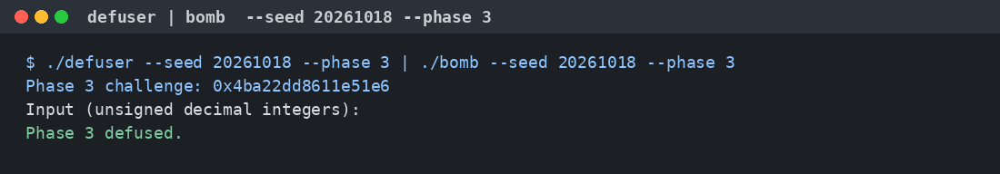
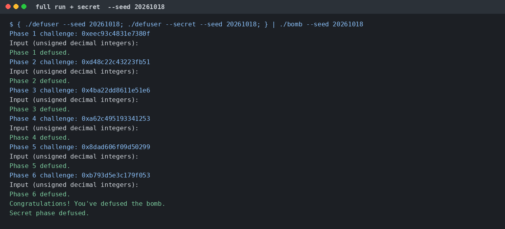
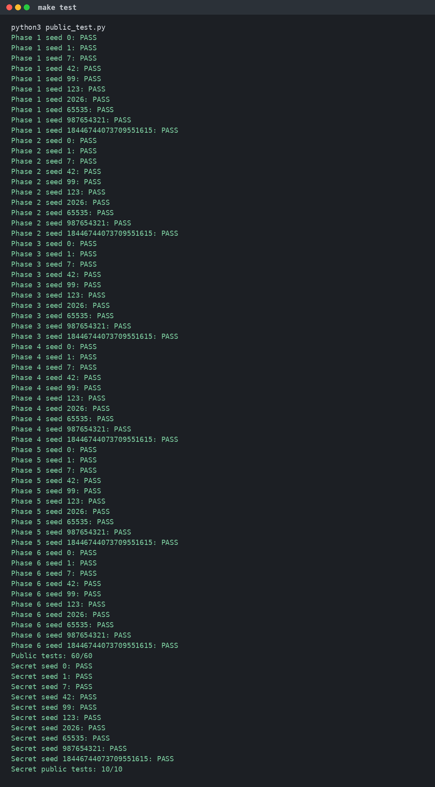

# ICS-Lab2: BombLab 实验报告

24300810019 吴世强

## 一、实验环境

- OS：Ubuntu 24.04.5 LTS（x86-64）
- GCC：13.3.0
- GDB：15.1
- objdump：GNU Binutils 2.42
- 个人炸弹：仓库根目录 `./bomb`，学号 `24300810019`

```text
$ gcc --version
gcc (Ubuntu 13.3.0-6ubuntu2~24.04.1) 13.3.0

$ gdb --version
GNU gdb (Ubuntu 15.1-1ubuntu1~24.04.1) 15.1

$ objdump --version
GNU objdump (GNU Binutils for Ubuntu) 2.42
```

反汇编统一用 Intel 语法：

```bash
objdump -d -M intel --no-show-raw-insn ./bomb
```

## 二、总体分析方法

每一关都按下面的顺序做，公式写进 `defuser.c` 之后再用炸弹本身验收。

1. 用 `objdump` 导出关卡入口，以及它 `call` 到的辅助函数。只看入口不够，真正的运算经常在 `p1_compute`、`p3_dispatch`、`p4_walk` 这类函数里。
2. 标出参数寄存器、`cmp` / `test` 后面的条件跳转、循环回边、间接跳转和间接调用。整数运算看目的寄存器是 `eax` 还是 `rax`：写到 `eax` 的加减乘和异或都是 32 位回绕。
3. 用 GDB 在调用点停下，核对寄存器。观察参数时用 `break *地址`，避免符号断点落到函数序言之后。调试信息写到 stderr，口令本身只从 `defuser` 的标准输出进 `bomb`。
4. 公开测试的 seed 是 `tests/public.json` 里的 10 个。下面每一关另外用 seed `20261018` 跑了一遍，这个 seed 不在公开列表里。

`phase_N` 的共同外壳是：`valid_u32_fields` 检查输入恰好是若干个无符号十进制整数，`sscanf` 用 `"%u"` 读进来，再和 challenge 算出的值比较。比较成功时返回值的最低字节是 1。`sete al` 只改 `al`，函数返回后不能把整个 `eax` 当成口令。

## 三、正式关卡

非公开验证统一用 seed `20261018`。六关对应的 challenge 如下。

| 关卡 | challenge |
| --- | --- |
| 1 | `0xeec93c4831e7380f` |
| 2 | `0xd48c22c43223fb51` |
| 3 | `0x4ba22dd8611e51e6` |
| 4 | `0xa62c495193341253` |
| 5 | `0x8dad606f09d50299` |
| 6 | `0xb793d5e3c179f053` |

### 第 1 关（函数调用、参数传递、返回值）

`phase_01` 只读 1 个整数。读入值要等于 `p1_compute(challenge)` 的返回值。

`p1_compute` 把 challenge 拆开，按 `p1_step1`、`p1_step0`、`p1_step2` 的顺序调用。System V ABI 里第一个整数参数在 `edi`，第二个在 `esi`，返回值在 `eax`。这三个函数都很短，没有改 `rdi` / `rsi` / `rdx`，所以调用方保存在 `edi`、`edx` 里的高低 32 位在返回后仍然有效。

```asm
p1_compute:
    mov    rdx, rdi
    mov    rax, rdi
    shr    rax, 0x20          ; hi  = challenge >> 32
    mov    rsi, rdx
    mov    edi, eax           ; arg1 = hi
    shr    rsi, 0x10          ; arg2 = (uint32)(challenge >> 16)
    call   p1_step1
    mov    esi, edi           ; step0 的第二个参数仍是 hi
    mov    edi, edx           ; step0 的第一个参数是 challenge 的低 32 位
    mov    ecx, eax           ; 暂存 step1
    call   p1_step0
    mov    esi, ecx
    mov    edi, eax
    call   p1_step2

p1_step1:                     ; (3 * hi + mid) ^ 0x1140
    lea    eax, [rdi+rdi*2]
    add    eax, esi
    xor    eax, 0x1140
p1_step0:                     ; (lo + 4 * hi) ^ 0xe668
    lea    eax, [rdi+rsi*4]
    xor    eax, 0xe668
p1_step2:                     ; 5 * (step0 - step1) + 0x8016
    sub    edi, esi
    lea    eax, [rdi+rdi*4+0x8016]
```

记 `lo = (uint32)challenge`，`mid = (uint32)(challenge >> 16)`，`hi = (uint32)(challenge >> 32)`。口令是一个 32 位整数：

```text
step1 = (3 * hi + mid) ^ 0x1140
step0 = (lo + 4 * hi) ^ 0xe668
口令  = 5 * (step0 - step1) + 0x8016
```

用 seed `20261018` 手算：`hi = 0xeec93c48`，`mid = 0x3c4831e7`，`lo = 0x31e7380f`，得到 `step1 = 0x08a3f7ff`，`step0 = 0xed0ccf47`，口令 `1980544126`（`0x760cb47e`）。GDB 在 `p1_compute` 的 `ret`（`0x402014`）处看到的 `eax` 就是 `0x760cb47e`。

```c
uint32_t hi = (uint32_t)(challenge >> 32);
uint32_t mid = (uint32_t)(challenge >> 16);
uint32_t lo = (uint32_t)challenge;
uint32_t step1 = (hi * 3u + mid) ^ 0x1140u;
uint32_t step0 = (lo + hi * 4u) ^ 0xe668u;
uint32_t answer = (step0 - step1) * 5u + 0x8016u;
```

```text
$ ./defuser --seed 20261018 --phase 1 | ./bomb --seed 20261018 --phase 1
Phase 1 challenge: 0xeec93c4831e7380f
Input (unsigned decimal integers):
Phase 1 defused.
```


### 第 2 关（数组、循环、递推关系）

`phase_02` 要求 6 个无符号整数，放在 `[rbp-0x40]` 开始的连续 6 个 `uint32` 里。第一个数单独比较，后面进入 `rdx = 1, 2, 3, 4, 5` 的循环。

```asm
mov    esi, DWORD PTR [rbp-0x40]     ; a[0]
mov    rax, r13                      ; r13 = challenge
shr    rax, 0x24
and    eax, 0x3f
cmp    esi, eax                      ; a[0] == (challenge >> 36) & 0x3f

mov    edx, 1
loop:
    lea    ecx, [rdx+0x7]            ; 移位量 = i + 7
    mov    rax, r13
    shr    rax, cl
    lea    ecx, [rsi+rsi*2]          ; 3 * a[i-1]
    mov    esi, DWORD PTR [rbp+rdx*4-0x40]
    and    eax, 0xf
    add    eax, edx                  ; ((challenge >> (i+7)) & 0xf) + i
    xor    eax, ecx
    cmp    esi, eax
    jne    fail
    add    rdx, 1
    cmp    rdx, 6
    jne    loop
```

循环里 `rsi` 在比较前被写成 `a[i]`。比较通过时它就是下一轮要用的前一项。`lea ecx, [rsi+rsi*2]` 是 32 位乘法，前一项乘 3 会回绕。

```text
a[0] = (challenge >> 36) & 0x3f
a[i] = (((challenge >> (i + 7)) & 0xf) + i) ^ (3 * a[i-1])    , i = 1..5
```

seed `20261018` 的口令是 `44 136 407 1236 3695 11097`。其中 `a[0] = (0xd48c22c43223fb51 >> 36) & 0x3f = 44`。

```text
$ ./defuser --seed 20261018 --phase 2 | ./bomb --seed 20261018 --phase 2
Phase 2 challenge: 0xd48c22c43223fb51
Input (unsigned decimal integers):
Phase 2 defused.
```


### 第 3 关（switch 分支与跳转表）

`phase_03` 读 2 个数。第一个数必须等于 `challenge & 7`，它也是跳转表下标。第二个数是对应 case 的返回值。

送进 case 的数据在调用前算好：

```asm
mov    edi, r12d
and    edi, 0x7
cmp    DWORD PTR [rbp-0x18], edi     ; 输入[0] == index
mov    rax, r12
mov    rsi, r12
shr    rax, 0x3
shr    rsi, 0x20
xor    esi, eax                      ; value = (uint32)(challenge >> 32)
                                     ;       ^ (uint32)(challenge >> 3)
call   p3_dispatch
```

`p3_dispatch` 在下标大于 7 时直接返回 0。否则：

```asm
notrack jmp QWORD PTR [rax*8+0x4057e0]
```

GDB 读出的表是 8 个代码地址，每个地址再 `jmp` 到一个 `p3_case_*`。表的下标和 case 编号不是同一个数：

| 下标 | 跳到 | 对 value `v` 的计算 |
| --- | --- | --- |
| 0 | `p3_case_6` | `5 * v + 0x6a11` |
| 1 | `p3_case_7` | `5 * v + 0x28280` |
| 2 | `p3_case_5` | `(2 * v) ^ 0x15c5` |
| 3 | `p3_case_1` | `3 * v + 0x6d47` |
| 4 | `p3_case_4` | `(v ^ 0x26a6) + (v >> 1)` |
| 5 | `p3_case_3` | `(2 * v) ^ 0x17bb` |
| 6 | `p3_case_2` | `5 * v + 0x49eda` |
| 7 | `p3_case_0` | `(v ^ 0xe9e5) + (v >> 2)` |

`lea eax, [rdi+rdi*4+imm]` 是 `5 * v + imm`，`lea eax, [rdi+rdi*2+imm]` 是 `3 * v + imm`，右移是逻辑右移。

seed `20261018` 在 `call p3_dispatch`（`0x402289`）处：`edi = 6`，`esi = 0x4781e7e4`。下标 6 走 `5 * v + 0x49eda`，得到 `1703814734`。口令是 `6 1703814734`。

```text
$ ./defuser --seed 20261018 --phase 3 | ./bomb --seed 20261018 --phase 3
Phase 3 challenge: 0x4ba22dd8611e51e6
Input (unsigned decimal integers):
Phase 3 defused.
```



### 第 4 关（递归调用与返回过程）

`phase_04` 读 1 个数，等于 `p4_walk` 的返回值。调用前的四个参数是：

```asm
mov    edi, r12d
and    edi, 0x7f          ; target = challenge & 0x7f，范围 0..127
xor    esi, esi           ; lo = 0
mov    edx, 0x7f          ; hi = 127
shr    rcx, 0x7
xor    ecx, eax           ; key = (uint32)(challenge >> 7) ^ (uint32)(challenge >> 32)
call   p4_walk
```

`p4_walk` 先算中点 `mid = lo + (hi - lo) / 2`。`mid == target` 时不再递归：

```asm
lea    eax, [rdi+0xf5]
xor    eax, ecx           ; (mid + 0xf5) ^ key
```

否则把 `ebx = mid + key` 留在被调用者保存的寄存器里，再按 `target` 和 `mid` 的大小递归。返回后统一做 `eax = 3 * 子结果`，再异或 `ebx`，左右两边的常数不同：

```asm
cmp    eax, edi
jb     left               ; target < mid
; target > mid
lea    esi, [rdi+0x1]     ; lo = mid + 1，hi 不变
call   p4_walk
lea    eax, [rax+rax*2]
xor    eax, ebx
xor    eax, 0xb           ; 向右：3 * child ^ (mid + key) ^ 0x0b

left:
lea    edx, [rdi-0x1]     ; hi = mid - 1，lo 不变
call   p4_walk
lea    eax, [rax+rax*2]
xor    eax, ebx
xor    eax, 0x19          ; 向左：3 * child ^ (mid + key) ^ 0x19
```

`target` 一定落在 `[0, 127]` 里，所以递归总会命中，不会把区间走空。深度最多 7 层。

`.rodata` 里有一段文字写“左分支 xor 0x14、右分支 xor 0x1a”。对照上面的指令，向左是 `xor eax, 0x19`，向右是 `xor eax, 0x0b`。口令按指令算，不按那段文字算。

seed `20261018` 在 `call p4_walk` 前：`target = 83`，`key = 0x050a2175`，`lo = 0`，`hi = 127`。沿这条路径折叠后的口令是 `4211183837`。

```text
$ ./defuser --seed 20261018 --phase 4 | ./bomb --seed 20261018 --phase 4
Phase 4 challenge: 0xa62c495193341253
Input (unsigned decimal integers):
Phase 4 defused.
```


### 第 5 关（结构体布局、指针、链表遍历）

`phase_05` 读 2 个数。第一个等于 `p5_traverse` 的返回值，第二个等于它写到输出指针里的结点标记。

结点是 16 字节，三个字段：

```text
+0  uint32  value
+4  uint32  tag
+8  uint64  next
```

`p5_heads` 在 `0x405b20`，8 个指针。`p5_nodes` 从 `0x405b60` 开始。把 `next` 串起来是一条 12 个结点的链，8 个表头分别指向链上的前 8 个结点。

| 链上序号 | value | tag | 地址 |
| --- | --- | --- | --- |
| 0 | 39 | 2905 | `0x405ba0` |
| 1 | 58934 | 1387 | `0x405c00` |
| 2 | 29285 | 1046 | `0x405be0` |
| 3 | 11053 | 600 | `0x405bc0` |
| 4 | 21877 | 1607 | `0x405b70` |
| 5 | 62709 | 22 | `0x405b60` |
| 6 | 51901 | 297 | `0x405bf0` |
| 7 | 6574 | 2390 | `0x405bb0` |
| 8 | 39139 | 2149 | `0x405b80` |
| 9 | 18887 | 780 | `0x405c10` |
| 10 | 61063 | 1893 | `0x405bd0` |
| 11 | 41750 | 2617 | `0x405b90` |

表头下标 `0..7` 就是链上序号 `0..7`。遍历过程：

```asm
and    eax, 0x7
mov    rdx, QWORD PTR [rax*8+0x405b20]   ; node = heads[challenge & 7]
shr    rax, 0x6
xor    eax, edi                           ; acc = (uint32)(challenge >> 6)
                                          ;     ^ (uint32)(challenge >> 32)
xor    eax, 0x564e
add    eax, DWORD PTR [rdx]               ; acc += node.value
lea    eax, [rax+rax*4]                   ; acc *= 5
mov    DWORD PTR [r8], esi                ; 第二个口令 = node.tag
xor    eax, esi                           ; acc ^= tag
and    edi, 0x3                           ; steps = (challenge >> 3) & 3
je     done                               ; steps == 0 时头结点就是终点
; 循环：沿 next 再走 steps 次，每次都是
; acc = (acc + node.value) * 5 ^ node.tag
; 并且用当前 tag 覆盖第二个口令
```

`steps` 为 0 时只处理头结点；为 1、2、3 时再沿 `next` 走相应次数。最长 4 个结点，而最短的一条链（表头 7）后面还有 5 个结点，不会走到空指针。

seed `20261018` 的 `challenge = 0x8dad606f09d50299`：表头下标 `(0x99 & 7) = 1`，`steps = 3`。从 value `58934` 的结点出发，再走 3 步，停在链上序号 4，tag 是 `1607`。折叠结果是 `4115344080`。口令是 `4115344080 1607`。

```text
$ ./defuser --seed 20261018 --phase 5 | ./bomb --seed 20261018 --phase 5
Phase 5 challenge: 0x8dad606f09d50299
Input (unsigned decimal integers):
Phase 5 defused.
```


### 第 6 关（函数指针表与间接调用）

`phase_06` 读 1 个数，等于 `p6_dispatch(challenge)`。函数指针表 `p6_ops` 在 `0x405dc0`。GDB `x/8gx 0x405dc0` 的结果，和 `objdump` 对得上：

| 下标 | 函数 | 操作 |
| --- | --- | --- |
| 0 | `p6_op_5` | `(4 * x + 0x4bd1) ^ (3 * x)` |
| 1 | `p6_op_0` | `rotl(x, 5) ^ 0x6201` |
| 2 | `p6_op_0` | 同上 |
| 3 | `p6_op_2` | `rotr(x, 3)` |
| 4 | `p6_op_5` | 同下标 0 |
| 5 | `p6_op_3` | `(x ^ 0x3055) + (x << 7)` |
| 6 | `p6_op_1` | `(x + 0xa8f) ^ (x >> 2)` |
| 7 | `p6_op_4` | `(x ^ (x >> 1)) + 0x2d18` |

`rotl` / `rotr` 的操作数是 `eax`，转的是 32 位。

```asm
shr    rdi, 0x6
xor    edi, eax                 ; state = (uint32)(challenge >> 6)
                                ;       ^ (uint32)(challenge >> 32)
and    ebx, 0x38                ; 第二下标的字节偏移：bits[5:3]
and    eax, 0x7                 ; 第一下标 = challenge & 7
call   QWORD PTR [rax*8+0x405dc0]
xor    eax, 0xf11b
mov    edi, eax
call   QWORD PTR [rbx+0x405dc0] ; rbx 已经是下标 * 8
add    eax, 0x2616
```

`and ebx, 0x38` 留下的是指针偏移，不是下标本身。偏移 `0, 8, ..., 56` 对应下标 `(challenge >> 3) & 7`。

```text
state = (uint32)(challenge >> 6) ^ (uint32)(challenge >> 32)
state = op[challenge & 7](state) ^ 0xf11b
口令  = op[(challenge >> 3) & 7](state) + 0x2616
```

seed `20261018` 的 `challenge = 0xb793d5e3c179f053`：初始 `state = 0x38963222`，第一下标 3（循环右移 3 位，得到 `0x4712c644`），异或 `0xf11b` 后是 `0x4712375f`，第二下标 2（循环左移 5 位再异或 `0x6201`，得到 `0xe24689e9`），加 `0x2616` 得出口令 `3796283391`。

```text
$ ./defuser --seed 20261018 --phase 6 | ./bomb --seed 20261018 --phase 6
Phase 6 challenge: 0xb793d5e3c179f053
Input (unsigned decimal integers):
Phase 6 defused.
```


## 四、Honor

六关全部通过后，`bomb` 还会读一行，交给 `secret_gate(input, challenge, context)`。`challenge` 是第 7 关的题目，`context` 是 `transcript_context`，由前六行口令混出来。这一关不会把 challenge 打印出来。GDB 断在 `secret_gate` 入口（`0x402690`）可以直接看参数：seed `20261018` 时 `rsi = 0xe12d7a318f08669a`，`rdx = 0x578ecccf42e6cea5`。

`secret_gate` 先检查长度，再把整行复制到栈上的缓冲区。

```asm
call   strlen
sub    rax, 0x24
cmp    rax, 0x7f
jbe    ok                 ; 36 <= strlen <= 163
...
call   secret_copy
cmp    DWORD PTR [rbp-0xb0], 0x4e45504f
                          ; 缓冲区偏移 32 处的 4 字节必须是 "OPEN"
lea    rdi, [rbp-0xac]    ; 从偏移 36 开始解析
call   secret_phase
```

小端序 `0x4e45504f` 是字符 `O P E N`。偏移 0 到 31 的 32 个字节没有再比较，只要中间没有 `'\0'` 即可。偏移 36 之后交给 `secret_phase`，它要求恰好 3 个无符号整数。`.rodata` 里另有一句“OPEN 后面两个字段、并且不用前六关成绩”，和这段代码不一致：`valid_u32_fields` 的第二个参数是 3，`context` 也参与了后面的运算。

三个数的比较是：

```asm
and    ecx, 0x3
cmp    DWORD PTR [rbp-0x2c], ecx     ; n0 == context & 3

shr    rsi, 0x20
shr    r8, 0x20
xor    esi, r12d                     ; cfold = hi(challenge) ^ lo(challenge)
xor    r8d, r13d                     ; xfold = hi(context) ^ lo(context)
shr    r13, 0x10
imul   r9d, ecx, 0x7754
xor    r9d, r13d                     ; salt = (n0 * 0x7754) ^ (uint32)(context >> 16)
mov    edi, esi
xor    edi, r8d                      ; mix 的输入 = cfold ^ xfold
call   secret_mix
xor    eax, r9d
cmp    DWORD PTR [rbp-0x28], eax     ; n1

shr    esi, 0x5
lea    edx, [r8+rcx*1+0xae2a]        ; xfold + n0 + 0xae2a
add    edx, esi                      ; + (cfold >> 5)
xor    eax, edx
cmp    eax, DWORD PTR [rbp-0x24]     ; n2
```

`secret_mix` 不改 `rsi`，所以 `shr esi, 5` 用的仍是 `cfold`：

```asm
secret_mix:                          ; ((v >> 5) ^ 0xae2a) + (v ^ 0x7754)
    mov    eax, edi
    xor    edi, 0x7754
    shr    eax, 0x5
    xor    eax, 0xae2a
    add    eax, edi
```

```text
n0 = context & 3
cfold = (uint32)(challenge >> 32) ^ (uint32)challenge
xfold = (uint32)(context >> 32) ^ (uint32)context
mix = ((cfold ^ xfold) >> 5 ^ 0xae2a) + ((cfold ^ xfold) ^ 0x7754)
n1 = mix ^ ((n0 * 0x7754) ^ (uint32)(context >> 16))
n2 = n1 ^ (xfold + n0 + 0xae2a + (cfold >> 5))
第七行 = <32 字节> + "OPEN " + n0 + " " + n1 + " " + n2
```

实现里那 32 字节用的是 `'.'`。seed `20261018` 算出 `n0 = 1`，`n1 = 3018261955`，`n2 = 2873023673`，整行是：

```text
................................OPEN 1 3018261955 2873023673
```

```text
$ { ./defuser --seed 20261018; ./defuser --secret --seed 20261018; } | ./bomb --seed 20261018
...
Congratulations! You've defused the bomb.
Secret phase defused.
```



## 五、公开测试与总体结果

```text
$ make test
Public tests: 60/60
Secret public tests: 10/10
```

10 个公开 seed 上，第 1 关到第 6 关以及 Honor 全部通过。完整输出见下图。



## 六、遇到的问题与解决

1. **32 位回绕。** 关卡里的 `lea`、`add`、`xor`、`shr` 大多写进 `eax` / `edi`。用 64 位整数直接乘，结果会和炸弹不一致。求解函数里的中间量都保持 `uint32_t`。
2. **跳转表下标不等于 case 名字。** `p3_case_0` 实际挂在下标 7，`p3_case_6` 挂在下标 0。先 `x/8gx 0x4057e0` 把 8 个目标地址记下来，再各自反汇编，避免按函数名字顺序填 switch。
3. **函数返回后的 `eax` 不能当口令。** 成功路径是 `sete al`，高位还留着比较前的残留。第 1 关改成停在 `p1_compute` 的 `ret` 上读 `eax`，那里才是真正的返回值。
4. **第 5 关的表头不是 8 条互不相干的链表。** 8 个指针指进同一条 12 结点的链。按 `next` 把链复原之后，表头 0 到 7 正好是链上序号 0 到 7。
5. **`.rodata` 里有和指令不符的说明。** 第 4 关那段文字写的异或常数是 `0x14` 和 `0x1a`，指令是 `0x19` 和 `0x0b`。Honor 那段文字写两个字段，`secret_phase` 实际用 `sscanf` 读三个 `%u`。以执行到的指令为准。
6. **Honor 的前缀位置是固定偏移。** 一开始把 `"OPEN"` 放在行首，`secret_gate` 比较的是复制缓冲区的第 32 字节，长度也不满足 `strlen >= 36`。改成 32 个字符再接 `"OPEN"` 之后，`secret_phase` 才开始解析三个整数。

## 七、参考资料与工具使用说明

**参考资料**

- 课程页面：<https://ics-26fall-fdu.github.io/>
- CS:APP 第 3 章（x86-64 过程调用、条件跳转、跳转表、递归、结构体与链表）
- System V AMD64 ABI：整数参数依次使用 `rdi`、`rsi`、`rdx`、`rcx`、`r8`、`r9`，返回值在 `rax`
- GDB 文档：<https://sourceware.org/gdb/documentation/>
- CS:APP x86-64 GDB 速查：<http://csapp.cs.cmu.edu/3e/docs/gdbnotes-x86-64.pdf>

**工具**

- `objdump -d -M intel`：导出 `phase_01` 到 `phase_06`、`secret_gate`、`secret_phase` 以及各关调用的辅助函数。
- `gdb`：在 `p1_compute` 返回前、`p3_dispatch` 调用前、`p4_walk` 调用前和 `secret_gate` 入口查看寄存器；用 `x/8gx` 读第 3 关跳转表和第 6 关函数指针表。
- `readelf` / 按虚拟地址换算文件偏移：把 `p5_nodes` 按 16 字节记录拆成 `value`、`tag`、`next`。
- Cursor 中的 AI 助手：用来对照反汇编整理调用关系和报告结构，并帮我把公式写成 `defuser.c`。每一关的口令都用 `./bomb` 实际跑过，公开测试是 `60/60`，Honor 是 `10/10`，非公开 seed `20261018` 也逐关通过。报告里的寄存器值和口令来自这些运行，不是只根据文字说明填写的。

## 八、意见与建议

关卡本身把调用约定、循环、跳转表、递归、链表和函数指针拆开了，适合对照 CS:APP 第 3 章。Honor 不打印 challenge，入口参数只能在 `secret_gate` 上看，报告模板里如果提前写一句“第七行前 32 字节不参与数值比较，第 32 字节开始要出现 OPEN”，定位会快一些。
